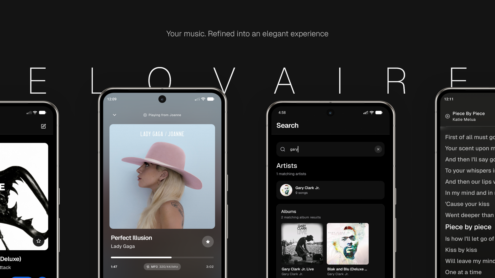
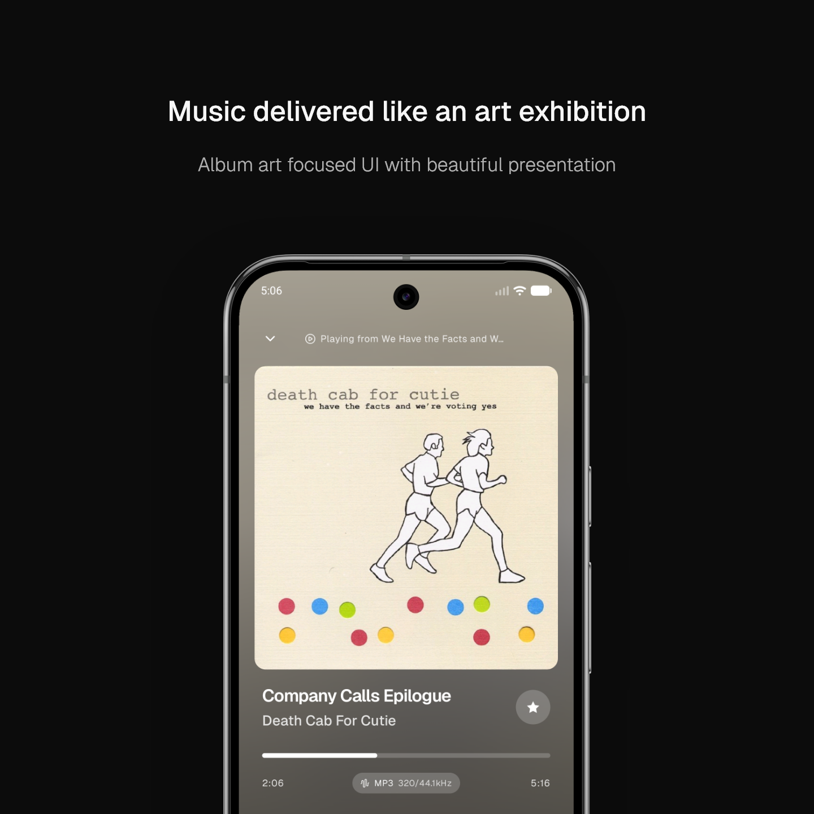
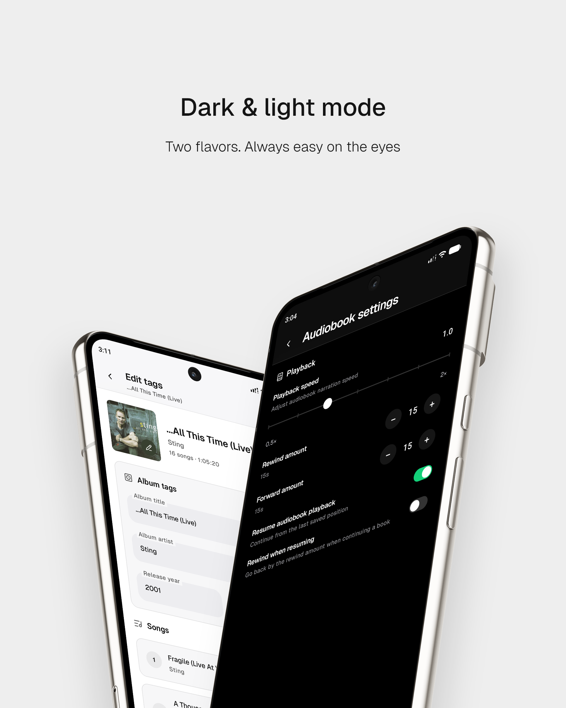
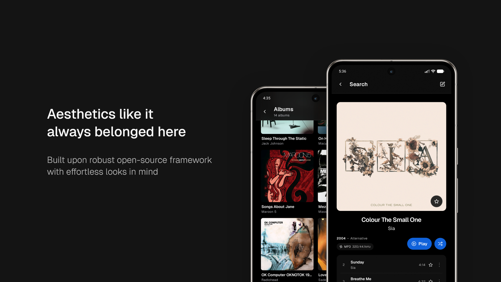
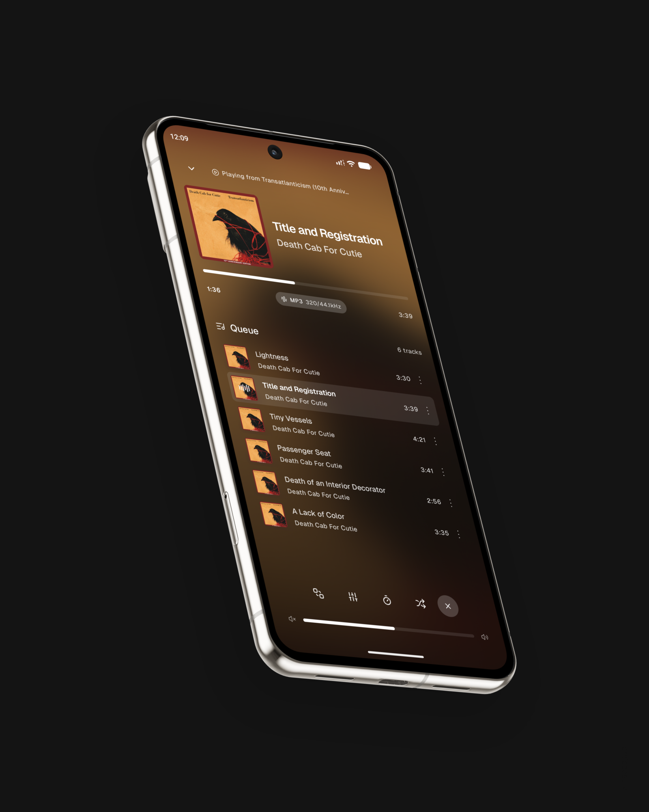
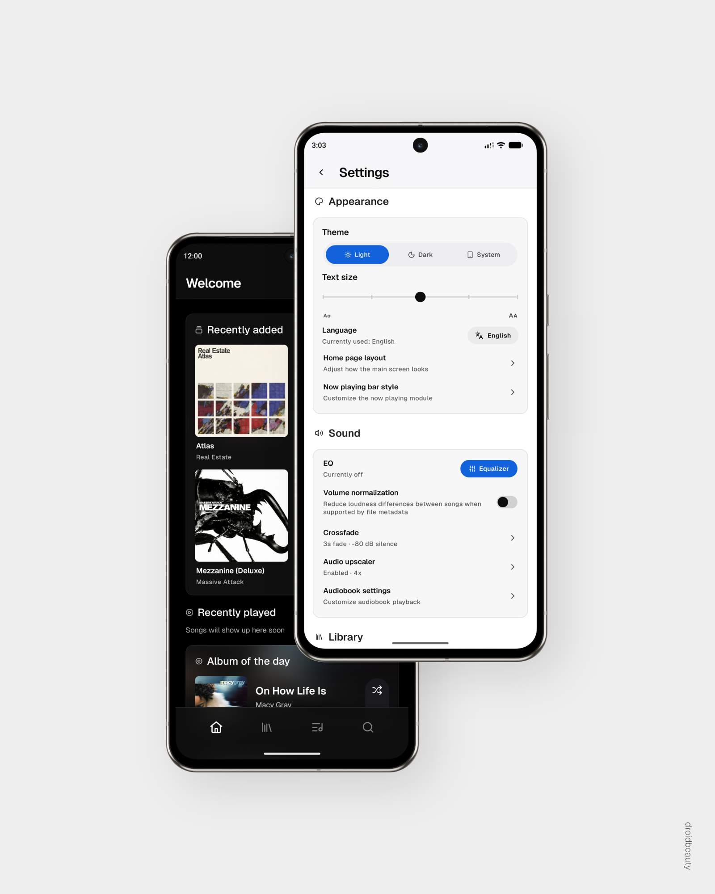
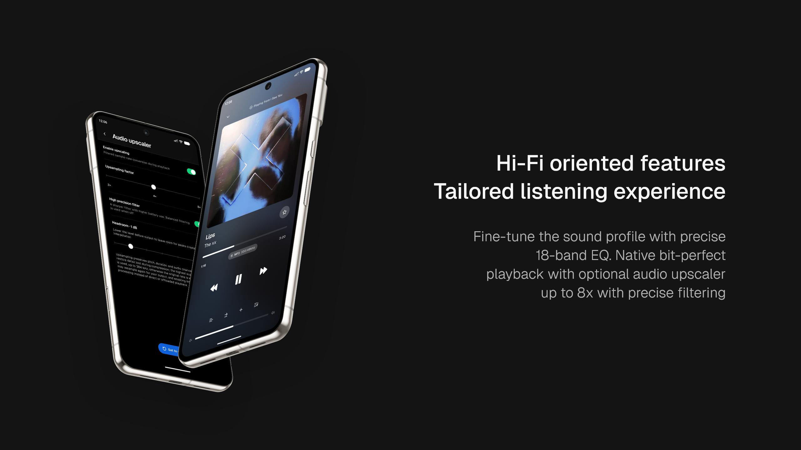
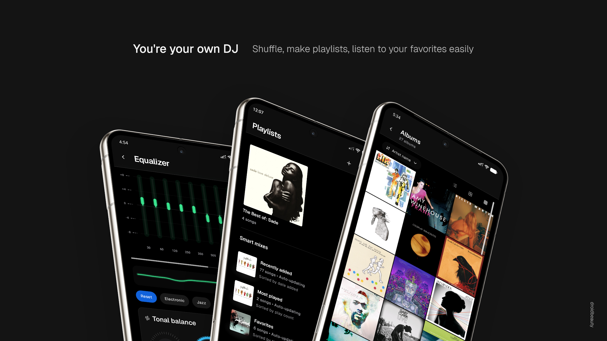

# Elovaire

  <b>Your music, given room to shine.</b>

  <a href="https://github.com/droidbeauty/elovaire-music/releases/latest"><strong>Download the latest release</strong></a>

  A music player for the collection you call your own. Browse, search and play your music offline, with album artwork woven through the experience

  

## Your collection, close at hand

Move between songs, albums, artists and playlists in a library that keeps your artwork in view. Find a track quickly, save favorites, make playlists and return to recently played music. Elovaire works with your local collection and can keep it in step as it changes.

<table>
  <tr>
    <td align="center" width="50%">
      
    </td>
    <td align="center" width="50%">
      
    </td>
  </tr>
</table>

## A player that stays with you

The full player brings the artwork, playback controls and queue together in one place. Lyrics can come from your music files or be looked up online, while the compact player keeps your current track within reach as you browse.

  

<table>
  <tr>
    <td align="center" width="50%">
      
    </td>
    <td align="center" width="50%">
      
    </td>
  </tr>
</table>

## Shape the sound

Fine-tune playback with an 18-band equalizer, ready-made presets, tone controls and optional spaciousness or reverb. The audio upscaler offers adjustable 2×, 4× and 8× sample-rate conversion, with filter precision and headroom controls.

  

## Made to feel at home

Choose light, dark or system appearance, adjust text size and arrange the home screen around the way you listen. Album art and restrained motion give the interface its quiet character.

  

## Support

Elovaire is an independent project for people who care about their music collection. It has no ads or subscriptions. If you enjoy using it, a tip helps support its continued development. Thank you for listening.

<a href="https://ko-fi.com/droidbeauty"><strong>Support Elovaire on Ko-fi</strong></a>

